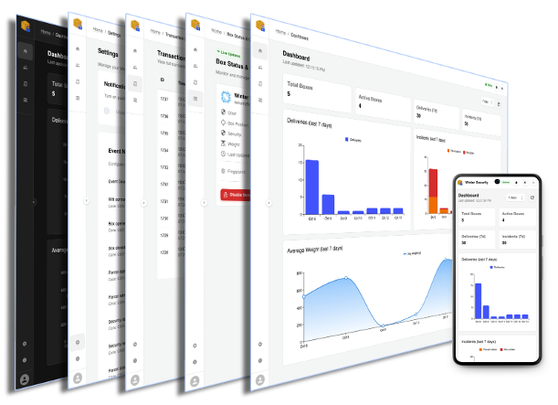
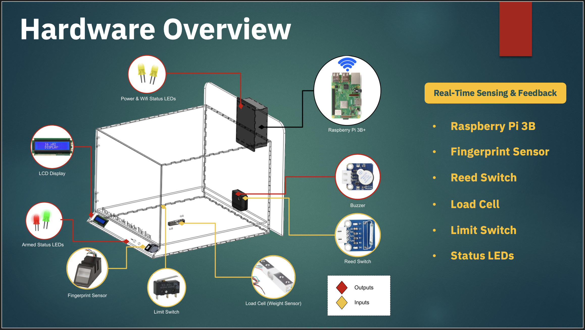

# Winter Security Box – IoT Security Management Platform

A web-based management application for an IoT-enabled smart security box, designed to provide secure parcel storage, remote monitoring, user management and real-time security notifications.

The application provides a centralised interface for managing security boxes, monitoring device activity, managing fingerprint access and reviewing transaction history.

## Application Screenshots

<p align="center">
  
</p>

## Hardware Overview
<p align="center">
  
</p>

## Overview

The Winter Security Box project combines IoT hardware with a web-based management platform to improve the security and convenience of parcel deliveries.

The React frontend communicates with backend APIs hosted on Azure to retrieve device information, manage users, process security-related operations and monitor activity. Real-time communication is handled through SignalR, while browser push notifications provide alerts for relevant security events.

The application supports multiple users and security boxes, with access management and event notification settings.

## Key Features

### Dashboard and Monitoring
- Dashboard displaying security box statistics and activity summaries.
- Visualisation of security events and historical activity.
- Monitoring of box status and recent events.
- Configurable reporting periods and dashboard refresh.

### Security Box Management
- View and manage registered security boxes.
- Monitor box status and security-related events.
- Receive real-time updates when transactions occur.
- Manually refresh device information when required.

### Fingerprint Access Management
- Register new fingerprint credentials through the connected security box.
- Remove existing fingerprint registrations.
- Monitor fingerprint registration progress through status polling.
- Associate fingerprint access with individual users and security boxes.

### User Management
- Create, view, update and delete user accounts.
- Manage user access to security boxes.
- Support multiple users and security devices.

### Transaction History
- View historical security and device transactions.
- Review event timestamps and associated security box information.
- Monitor security-related activities through a transaction history interface.

### Real-Time Notifications
- SignalR integration for receiving real-time updates from the backend.
- Browser push notifications using the Web Push API.
- Configurable notification preferences for different event types.
- Visual alerts for important security events.

### Account and Settings
- User authentication and session management.
- Profile and account management.
- Configurable event notification preferences.
- Responsive interface for desktop and mobile devices.

## Technology Stack

| Category | Technologies |
|---|---|
| Frontend | React 19, TypeScript, JavaScript, HTML5, CSS3 |
| UI Framework | Material UI (MUI) |
| Data Visualisation | MUI X Charts |
| Data Tables | MUI X Data Grid |
| Routing | React Router |
| Real-Time Communication | Microsoft SignalR Client |
| Notifications | Web Push API, Service Workers |
| API Integration | REST APIs, Fetch API |
| Cryptography Library | CryptoJS |
| Cloud Platform | Microsoft Azure |
| Hosting / Deployment | Azure Static Web Apps |

## Architecture and Communication

The frontend communicates with the backend through REST APIs and SignalR.

```text
              User / Browser
                    |
                    v
          React Web Application
             (TypeScript)
                    |
          +---------+---------+
          |                   |
          v                   v
      REST APIs          SignalR Client
          |                   |
          +---------+---------+
                    |
                    v
          Azure Backend Services
             (Azure Functions)
                    |
          +---------+---------+
          |                   |
          v                   v
      Data Storage       IoT Security Box
                              |
                    +---------+---------+
                    |                   |
                    v                   v
              Fingerprint           Security
               Sensor               Events
```

*The diagram illustrates the frontend's integration points and the overall system concept. Backend implementation details and the underlying storage architecture are not included in this frontend repository.*

## Real-Time Communication

SignalR is used to maintain a real-time connection between the web application and backend services.

When security box transactions or relevant events occur, the backend can notify connected clients. The frontend processes these events and updates relevant information, including:

- Security box information.
- Transaction and activity records.
- Application notifications and alerts.

The application also handles connection status and reconnection attempts to maintain communication with the backend.

## Push Notifications

The application supports browser-based push notifications through the Web Push API and service workers.

Users can receive notifications about relevant security events even when the application is not actively being viewed, subject to browser support and notification permissions.

## Getting Started

### Prerequisites

- Node.js and npm
- A modern web browser
- Access to the configured backend API services for full application functionality

### Installation

Clone the repository:

```bash
git clone <your-repository-url>
```

Navigate to the project directory:

```bash
cd securitybox-web-app
```

Install dependencies:

```bash
npm install
```

Start the development server:

```bash
npm start
```

The application will normally be available at:

```text
http://localhost:3000
```

### Backend Configuration

The frontend requires access to the corresponding backend API services for authentication, user management, security box operations, transaction retrieval and real-time communication.

Configure the backend API endpoint and required service settings before running the application. Do not commit Azure Function keys, credentials or other private configuration to the repository.

## Project Structure

```text
securitybox-web-app/
├── public/
│   ├── service-worker.js
│   ├── manifest.json
│   └── ...
├── src/
│   ├── alerts/          # Application alert management
│   ├── components/     # Reusable UI components
│   ├── config/         # Application configuration
│   ├── constants/      # Shared constants
│   ├── contexts/       # Authentication and SignalR contexts
│   ├── hooks/          # Custom React hooks
│   ├── interfaces/     # TypeScript interfaces
│   ├── layout/         # Application layout
│   ├── pages/          # Application pages
│   ├── routes/         # Application routing and route protection
│   ├── services/       # Backend API integration
│   ├── theme/          # UI theme configuration
│   └── utils/          # Utility functions
├── package.json
└── tsconfig.json
```

## Engineering Highlights

This project provided practical experience in:

- Building a responsive single-page application using React and TypeScript.
- Integrating frontend applications with RESTful backend services.
- Implementing real-time communication using SignalR.
- Integrating IoT device operations with a web-based management interface.
- Implementing fingerprint registration workflows with asynchronous status polling.
- Developing browser push notifications using service workers and the Web Push API.
- Managing authentication state, protected routes and user sessions.
- Building interactive dashboards and data visualisations using Material UI.

## Licence

See the [LICENSE](LICENSE) file for licensing information.